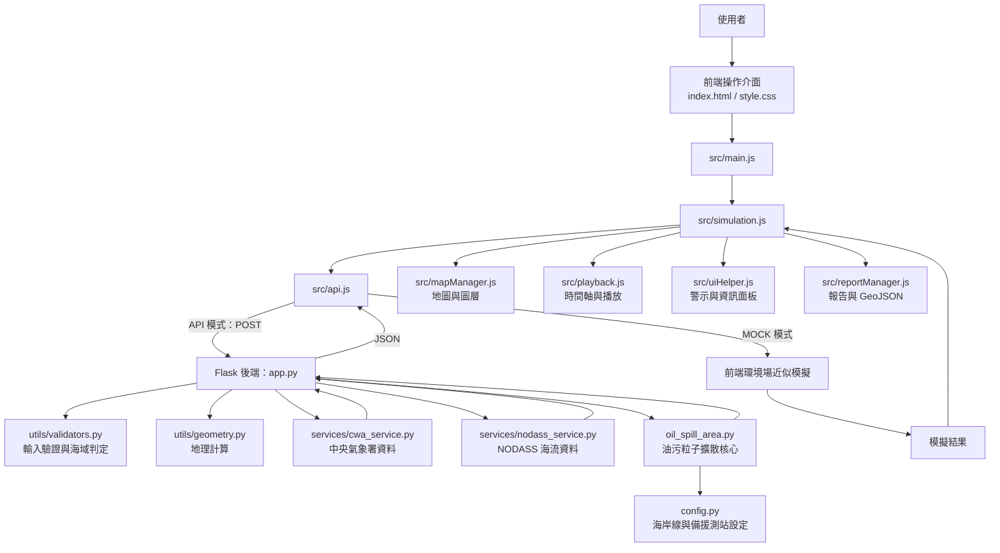
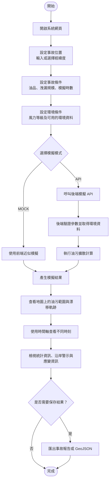

# 2026 NTOU Hackathon --- 油跡可循_台灣海洋油汙擴散模擬系統

本專案是一套以互動地圖呈現海上油污擴散情境的模擬系統。使用者可以設定事故位置、模擬時間、油品類型、洩漏規模與風力等級，觀察油污可能的漂移與擴散情形，並檢視相關環境資訊、沿岸風險及應變資源。

系統採用 **HTML、CSS、JavaScript 前端**搭配 **Python Flask
後端**。前端提供 MOCK 模擬模式，也能透過 API
呼叫後端模型；後端則整合氣象與海流資料服務，執行油污粒子擴散計算並回傳結果。

> **重要提醒：**
> 本專案目前定位為展示與決策支援原型。模擬結果不應直接視為實際海況預報或正式應變指令；實務使用前仍需進行模型校驗、資料品質檢查及專業人員評估。

------------------------------------------------------------------------

## 目錄

-   [功能特色](#功能特色)
-   [系統架構](#系統架構)
-   [專案目錄](#專案目錄)
-   [技術組成](#技術組成)
-   [執行流程](#執行流程)
-   [安裝與啟動](#安裝與啟動)
-   [環境變數與 API 設定](#環境變數與-api-設定)
-   [API 端點](#api-端點)
-   [主要模組說明](#主要模組說明)
-   [限制與注意事項](#限制與注意事項)

------------------------------------------------------------------------

## 功能特色

-   **互動式地圖**：以 Leaflet 呈現地圖與油污擴散結果。
-   **多種模擬模式**：支援前端 MOCK 模式及 Flask API 模式。
-   **油品與洩漏規模設定**：可選擇不同油品特性與事故規模。
-   **油污粒子擴散**：以粒子方式模擬油污隨風場、海流變化的漂移。
-   **環境資料整合**：後端可取得中央氣象署氣象資料與 NODASS
    海流資料，並在資料無法取得時使用備援方式。
-   **時間軸與播放控制**：瀏覽不同時間步的模擬結果。
-   **風險與應變資訊**：呈現沿岸敏感區、事故情境及應變資源等資訊。
-   **結果匯出**：提供事故報告與 GeoJSON 匯出功能。

## 系統架構



### 架構分層

  -------------------------------------------------------------------------------------------------------------
  層次                    主要檔案                                 職責
  ----------------------- ---------------------------------------- --------------------------------------------
  使用者介面              `index.html`、`style.css`                輸入事故參數、呈現地圖與資訊面板

  前端流程控制            `src/main.js`、`src/simulation.js`       綁定事件、協調模擬與更新畫面

  前端 API 與 MOCK        `src/api.js`                             根據模式產生模擬資料或呼叫後端 API

  地圖與播放              `src/mapManager.js`、`src/playback.js`   管理地圖圖層、軌跡與時間播放

  後端 API                `app.py`                                 接收請求、驗證輸入、整合環境資料與模擬結果

  核心模擬                `oil_spill_area.py`                      建立油污粒子、計算移動與擴散範圍

  外部資料服務            `services/`                              取得氣象與海流資料

  共用工具與設定          `utils/`、`config.py`                    輸入驗證、地理運算、海岸線及備援測站

  結果輸出                `src/reportManager.js`                   產生事故報告與 GeoJSON
  -------------------------------------------------------------------------------------------------------------

## 專案目錄

``` text
2026_ntou_hackathon/
├── app.py                       # Flask 後端入口與 API 路由
├── oil_spill_area.py             # 油污粒子擴散核心模型
├── config.py                     # 海岸線多邊形與備援海流測站
├── index.html                    # 前端主頁與操作介面
├── style.css                     # 前端樣式
├── requirements.txt              # Python 套件依賴
├── Procfile                      # 部署平台啟動指令
├── config.example.json           # API 金鑰設定範例
├── README.md                     # 專案說明
├── services/
│   ├── __init__.py
│   ├── cwa_service.py             # 中央氣象署氣象資料服務
│   └── nodass_service.py          # NODASS 海流資料服務
├── utils/
│   ├── __init__.py
│   ├── geometry.py                # 地理距離、陸地與測站計算
│   └── validators.py              # 輸入參數與油品／海域驗證
└── src/
    ├── api.js                     # API 通訊與 MOCK 模擬
    ├── config.js                  # 前端海岸敏感區等設定
    ├── config.json                # 前端設定檔（請勿放置秘密金鑰）
    ├── constants.js               # 油品、事故情境、應變資源等常數
    ├── main.js                    # 前端入口與事件綁定
    ├── mapManager.js              # 地圖初始化與圖層管理
    ├── playback.js                # 時間軸與播放控制
    ├── reportManager.js            # 事故報告與 GeoJSON 匯出
    ├── simulation.js              # 模擬流程協調
    ├── state.js                   # 共用應用程式狀態
    └── uiHelper.js                # 資訊面板、狀態與警示 UI
```

## 技術組成

### 前端

-   HTML5、CSS、原生 JavaScript ES Modules
-   [Leaflet](https://leafletjs.com/)：互動地圖
-   外部地圖圖磚服務：提供底圖顯示

### 後端

-   Python
-   [Flask](https://flask.palletsprojects.com/)：HTTP API 與靜態檔案服務
-   Flask-CORS：跨來源請求設定
-   Requests：向外部資料服務發出 HTTP 請求
-   Gunicorn：部署時的 WSGI 伺服器


## 產品功能與操作說明

本系統的操作流程可分為「設定事故情境、執行模擬、查看結果、匯出資料」四個階段。使用者不需要理解底層模型，即可透過網頁控制面板設定情境並觀察模擬結果。

### 使用者操作流程圖



### 操作步驟

1. **開啟系統**：在瀏覽器進入已部署的網站，或依照「安裝與啟動」章節於本機啟動 Flask。
2. **設定事故位置**：在操作介面設定事故發生的座標。請確認經緯度順序與數值正確。
3. **設定事故情境**：選擇油品種類、洩漏規模及模擬時數；依介面提供的選項設定風力等條件。
4. **選擇模擬模式並開始**：
   - **MOCK 模式**：適合快速體驗介面與模擬展示，不依賴後端即時運算。
   - **API 模式**：透過後端執行模擬；需確認後端服務與必要的外部資料服務可正常連線。
5. **閱讀地圖結果**：觀察油污分布範圍、漂移軌跡及地圖上的相關圖層。不同圖層的實際顯示內容以目前介面為準。
6. **查看時間變化**：使用時間軸或播放控制，檢視油污在不同模擬時間點的變化。
7. **檢視風險與統計資訊**：閱讀面積、漂移距離、環境資料狀態、沿岸敏感區及應變資源等資訊；資料欄位會依模擬結果與資料可用性而有所不同。
8. **匯出結果**：如需留存或在其他 GIS 工具中使用，可透過介面提供的功能匯出事故報告或 GeoJSON。

### 後端執行流程

1.  使用者在網頁設定事故座標、油品、洩漏規模、模擬時數與風力等級。
2.  `src/main.js` 接收使用者操作，並呼叫 `src/simulation.js`。
3.  `src/api.js` 依照所選模式決定使用 MOCK 模擬或呼叫 Flask API。
4.  API 模式下，`app.py` 解析並驗證請求參數。
5.  後端透過 `services/cwa_service.py` 與 `services/nodass_service.py`
    取得環境資料；必要時使用程式內的備援資料或近似變化模型。
6.  `oil_spill_area.py` 執行粒子移動與擴散計算。
7.  後端整理逐時結果、粒子座標、擴散範圍與相關統計，並以 JSON 回傳。
8.  前端更新地圖、時間軸、統計資訊及報告內容，使用者可檢視或匯出結果。

## 安裝與啟動

### 需求

-   Python 3.10 或相容版本（建議使用虛擬環境）
-   pip
-   可連線至外部資料服務的網路（若要取得即時／外部環境資料）

### 1. 下載專案

``` bash
git clone https://github.com/sarah21392773/2026_ntou_hackathon.git
cd 2026_ntou_hackathon
```

### 2. 建立虛擬環境

Windows：

``` powershell
python -m venv .venv
.\.venv\Scripts\Activate.ps1
```

macOS / Linux：

``` bash
python3 -m venv .venv
source .venv/bin/activate
```

### 3. 安裝 Python 套件

``` bash
python -m pip install --upgrade pip
pip install -r requirements.txt
```

### 4. 設定中央氣象署 API 金鑰（選用）

若要使用中央氣象署資料，請在專案根目錄建立本機 `config.json`，內容如下：

``` json
{
  "cwa_api_key": "YOUR_CWA_API_KEY"
}
```

也可以設定環境變數 `CWAR_API_KEY`。請勿將真正的 API 金鑰提交到 GitHub。

### 5. 啟動 Flask

``` bash
python app.py
```

接著用瀏覽器開啟：

``` text
http://127.0.0.1:5000/
```

Flask 應用程式會提供前端頁面與 API。若使用前端 API 模式，請確認
`src/constants.js` 中的 `API_CONFIG.baseUrl`
指向目前執行的後端。專案現有設定會在主機名稱為 `127.0.0.1` 時使用本機
API，其他情況則使用程式內設定的部署 API 網址。

> 若只是想先檢視前端，可透過靜態伺服器開啟網頁並選擇 MOCK 模式；若使用
> API 模式，必須確保後端網址可連線且路由設定正確。

## 環境變數與 API 設定

  -----------------------------------------------------------------------
  設定                                用途
  ----------------------------------- -----------------------------------
  `CWAR_API_KEY`                      中央氣象署 API
                                      金鑰；程式也會嘗試從根目錄
                                      `config.json` 讀取

  `src/constants.js` 的               前端使用的後端 API 基底網址
  `API_CONFIG.baseUrl`                

  `src/constants.js` 的               模擬 API 路徑，預設為
  `API_CONFIG.endpoint`               `/simulate-spill`
  -----------------------------------------------------------------------

請將本機設定檔與秘密資訊加入 `.gitignore`，並以 `config.example.json`
提供不含真實金鑰的範本。

## API 端點

### `POST /api/v1/simulate-spill`

前端 API 模式使用的主要模擬端點。

請求範例：

``` json
{
  "lat": 22.61,
  "lng": 120.26,
  "simulationHours": 24,
  "windForce": 2,
  "oilType": "HFO",
  "spillSize": "medium"
}
```

回應內容包含模擬狀態、事故起始位置與時間、風場與海流資訊、資料來源狀態，以及逐時間步的模擬歷史資料。實際欄位以
`app.py` 的回應格式為準。

### `POST /api/simulate`

另一個相容的模擬端點，使用 `oil_type`、`spill_size`
等底線命名欄位，並回傳 `history` 等模擬結果。

### `GET /`

回傳前端主頁。

> API
> 的輸入參數會經過驗證。若請求格式錯誤或參數不合法，伺服器會回傳錯誤狀態與訊息；模擬執行失敗時則回傳伺服器錯誤。

## 主要模組說明

  --------------------------------------------------------------------------------------------------------
  檔案                                  說明
  ------------------------------------- ------------------------------------------------------------------
  `app.py`                              Flask 應用程式、API 路由、輸入解析、資料服務整合與結果格式化

  `oil_spill_area.py`                   建立初始油污粒子、估算粒子移動、計算中心與擴散面積、產生擴散範圍

  `services/cwa_service.py`             讀取金鑰並請求中央氣象署氣象資料；在資料不可用時提供備援處理

  `services/nodass_service.py`          請求 NODASS 海流資料，處理服務回應

  `utils/validators.py`                 驗證座標、模擬時數、油品、洩漏規模與區域等輸入

  `utils/geometry.py`                   陸地判定、兩點距離與最近海流測站搜尋

  `config.py`                           台灣本島海岸線近似多邊形與海流備援測站資料

  `src/main.js`                         初始化介面事件與使用者操作流程

  `src/api.js`                          MOCK 資料生成、前端輔助地理計算及後端 API 呼叫

  `src/simulation.js`                   管理模擬啟動、結果接收、錯誤處理與畫面更新

  `src/mapManager.js`                   初始化 Leaflet 地圖並呈現模擬圖層

  `src/playback.js`                     控制逐時模擬播放與時間軸

  `src/uiHelper.js`                     更新資訊面板、警示與狀態呈現

  `src/reportManager.js`                整理事故摘要與匯出報告、GeoJSON

  `src/state.js`                        保存前端共用狀態

  `src/config.js`、`src/constants.js`   前端設定、油品特性、歷史事故與應變資源等資料
  --------------------------------------------------------------------------------------------------------

## 限制與注意事項

-   **資料來源可能變動或失效**：外部服務可能逾時、無法連線或回傳不完整資料，系統可能改用備援資料或近似模型。
-   **模型屬於簡化模擬**：風場、海流、粒子移動及油污範圍估算均有假設，結果不等同於經驗證的海洋污染預報。
-   **地理判定為近似值**：程式中的台灣海岸線多邊形與備援測站清單是簡化設定，不能取代高精度海岸線或正式海圖。
-   **MOCK 與 API 結果不同**：MOCK 模式使用前端的近似模擬；API
    模式使用後端模型及其資料服務，兩者的結果不保證一致。
-   **金鑰安全**：不可將 API 金鑰寫入公開前端程式或提交到公開
    Repository。若曾公開提交金鑰，請立即至資料提供者平台撤銷／更換，並清除程式中的明文金鑰。
-   **安全性與部署**：正式部署前應檢查 CORS、HTTPS、錯誤處理、外部請求的
    TLS 憑證驗證、日誌及 API 存取控制設定。

------------------------------------------------------------------------

## 開發與貢獻

歡迎依照專案需求改善模擬模型、環境資料處理、地理資訊呈現及使用者操作體驗。提交變更前，請先確認：

1.  沒有提交 API 金鑰、密碼或其他秘密資訊。
2.  前後端 API 路徑與請求／回應欄位一致。
3.  外部資料服務失敗時，錯誤訊息與備援流程可正常運作。
4.  地圖呈現、時間軸與報告匯出功能皆經過基本測試。

## License

本專案尚需由作者確認授權條款。若要公開供他人使用或修改，建議在
Repository 中加入適合的 `LICENSE` 檔案。
